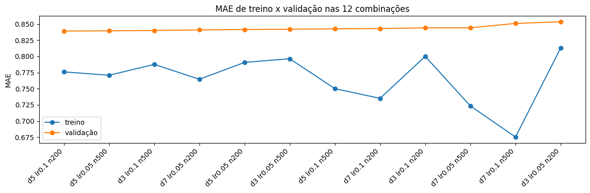
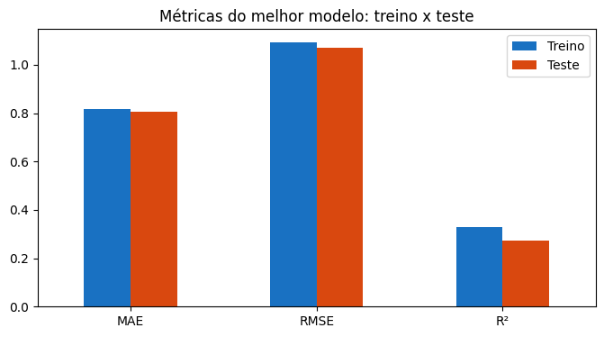
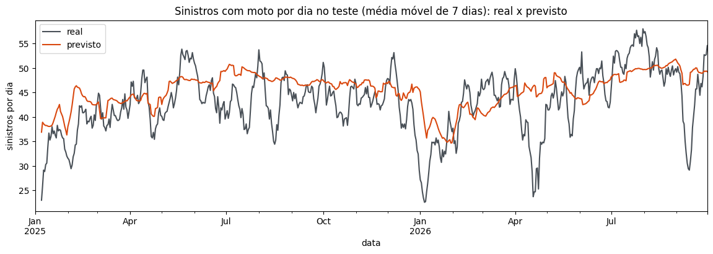
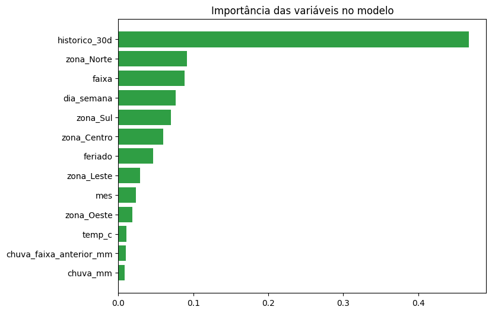
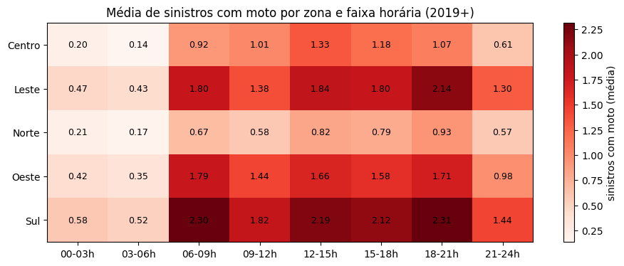
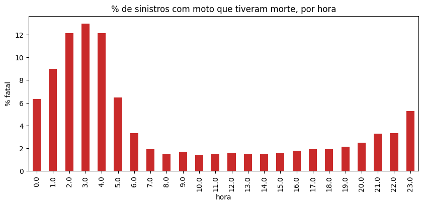

# RotaViva: previsão de risco de sinistros com motos em São Paulo

Global Solution 2026.2 – CitizenTech – Inteligência Artificial e Machine Learning

## 1. Problema e pergunta

Entre janeiro e setembro de 2026, 379 motociclistas morreram no trânsito da cidade de São Paulo. É o maior número para esse período desde 2015, quando o Infosiga começou a registrar os dados, e corresponde a quase metade (cerca de 48%) de todas as mortes no trânsito da capital no mesmo intervalo. Boa parte dessas vítimas são entregadores e trabalhadores que dependem da moto para chegar ao serviço.

Quem anda de moto pela cidade sabe que existem horários e regiões mais perigosos, mas essa percepção não vira informação concreta, nem para o motociclista nem para quem cuida da segurança. A ideia do RotaViva é transformar os dados públicos de sinistros em um nível de risco calculado com antecedência. Com ele, um aplicativo de navegação pode avisar o motociclista para redobrar a atenção, e órgãos como PM, CET, SAMU e Bombeiros podem decidir onde e quando reforçar patrulhas e equipes.

A pergunta que o modelo responde é: considerando a zona da cidade, o dia, a faixa de três horas e a chuva, quantos sinistros envolvendo motos devemos esperar? A partir dessa previsão, cada período é classificado em um de quatro níveis: baixo, moderado, alto ou crítico.

O projeto se relaciona principalmente com o ODS 3 (meta 3.6, redução de mortes no trânsito), com o ODS 11 (meta 11.2, transporte seguro) e, por usar dados de chuva, com o ODS 13.

## 2. Dados utilizados

Trabalhamos com duas bases públicas.

| Base | Fonte | Link | Período |
|---|---|---|---|
| Sinistros de trânsito | Infosiga SP (Detran-SP) | https://infosiga.detran.sp.gov.br/ | 01/01/2019 a 30/09/2026 |
| Chuva e temperatura por hora | INMET, estação A701 (Mirante de Santana) | https://portal.inmet.gov.br/dadoshistoricos | 01/01/2019 a 31/10/2026 |

O Infosiga separa os dados em sinistros, pessoas e veículos. Usamos apenas a base de sinistros, que já traz data, hora, coordenadas, quantidade de motos envolvidas e gravidade.

## 3. Preparação dos dados

A base de sinistros tinha 343.241 registros na cidade de São Paulo. Nem todos serviam para o nosso objetivo, então aplicamos alguns filtros.

Primeiro, descartamos os registros do tipo "notificação", que são avisos ainda não confirmados, e ficamos só com os sinistros fatais e não fatais. Depois, cortamos tudo antes de 2019: até 2018 o Infosiga registrava apenas sinistros com morte, o que distorceria a contagem. Em seguida, mantivemos apenas os casos com pelo menos uma moto envolvida, chegando a 134.338 sinistros. Por fim, removemos os registros sem hora ou com coordenadas fora dos limites da cidade, o que deixou 129.069 sinistros, uma perda de cerca de 4%.

Para trabalhar com a ideia de "onde", dividimos a cidade em cinco zonas, tomando como referência o Marco Zero, na Praça da Sé. Pontos a até 5 km dele formam o Centro, e os demais são classificados em Norte, Sul, Leste ou Oeste conforme a direção em relação ao Marco Zero. É uma aproximação das zonas oficiais, mas é simples de explicar e suficiente para orientar alertas e patrulhas.

A base de treino ficou com uma linha para cada combinação de zona, dia e faixa de três horas, totalizando 113.200 linhas. O valor a prever é a quantidade de sinistros com moto naquele período. Fizemos questão de incluir também os períodos em que não houve nenhum sinistro (40,9% das linhas), porque sem eles o modelo nunca aprenderia como é um período tranquilo.

As variáveis de entrada são todas informações disponíveis antes de o sinistro acontecer:

| Grupo | Variáveis |
|---|---|
| Local e horário | zona e faixa de três horas |
| Calendário | dia da semana, mês e feriado (nacional, estadual ou municipal) |
| Clima | chuva na faixa, chuva na faixa anterior e temperatura média |
| Histórico | média de sinistros da mesma zona e faixa entre 60 e 31 dias antes |

A variável de histórico tem uma defasagem de um mês de propósito. Como o Infosiga é atualizado mensalmente, usar os últimos dias seria trapaça: na prática, esses dados ainda não estariam publicados no momento da previsão.

A divisão entre treino e teste foi feita pelo tempo, não de forma aleatória. O modelo aprendeu com os dados de 2019 a 2024 (87.680 linhas) e foi avaliado em janeiro de 2025 a setembro de 2026 (25.520 linhas), um período que ele nunca viu. Assim simulamos o uso real, em que se aprende com o passado para prever o futuro.

Para ter uma referência, também criamos uma previsão simples, sem modelo: a média histórica de sinistros por zona, faixa horária e fim de semana. Se o modelo não superasse essa regra, não faria sentido usá-lo.

## 4. Escolha do modelo

Escolhemos o XGBoost, configurado para regressão de Poisson (objective="count:poisson"). Pesaram nessa decisão quatro pontos.

O primeiro é o tipo de dado: tabelas com variáveis numéricas e categóricas, cenário em que o XGBoost costuma ir muito bem. O segundo é que encontramos relações que dependem de combinações de fatores. Na análise exploratória, a chuva fraca no horário de pico da manhã aumentou os sinistros (às 7h, a média passou de cerca de 3,0 para 3,4 por hora), enquanto a chuva moderada ou forte reduziu os casos, provavelmente porque menos motos saem às ruas. Um modelo baseado em árvores consegue capturar esse tipo de interação. O terceiro é que o XGBoost lida sozinho com valores faltantes, o que foi útil nas horas em que a estação do INMET não registrou medição. O quarto é a natureza do alvo: estamos prevendo uma contagem, com muitos zeros, e a regressão de Poisson foi feita justamente para isso.

## 5. Treino com diferentes hiperparâmetros

Testamos 12 combinações de três hiperparâmetros com GridSearchCV: profundidade das árvores (max_depth de 3, 5 e 7), taxa de aprendizado (learning_rate de 0,05 e 0,1) e número de árvores (n_estimators de 200 e 500). A validação cruzada foi feita apenas dentro do período de treino, com TimeSeriesSplit em três divisões. Dessa forma, cada validação acontece sempre em um período posterior ao usado para treinar. A métrica de comparação foi o erro médio absoluto (MAE).

| max_depth | learning_rate | n_estimators | MAE treino | MAE validação | Diferença |
|---|---|---|---|---|---|
| 5 | 0,10 | 200 | 0,776 | 0,839 | 0,063 |
| 5 | 0,05 | 500 | 0,771 | 0,840 | 0,069 |
| 3 | 0,10 | 500 | 0,788 | 0,840 | 0,052 |
| 7 | 0,10 | 200 | 0,735 | 0,843 | 0,108 |
| 7 | 0,05 | 500 | 0,723 | 0,844 | 0,121 |
| 7 | 0,10 | 500 | 0,675 | 0,851 | 0,176 |
| 3 | 0,05 | 200 | 0,813 | 0,854 | 0,040 |

A tabela mostra 7 das 12 combinações; todas estão no notebook, na seção 14.1.

O gráfico deixa claro o efeito do overfitting. A configuração mais complexa (profundidade 7, 500 árvores e taxa 0,1) teve o menor erro no treino, 0,675, e o pior na validação, 0,851. Ela decorou os dados de treino em vez de aprender padrões gerais. No outro extremo, a configuração mais simples (profundidade 3, taxa 0,05 e 200 árvores) errou mais nos dois casos, sinal de que aprendeu pouco. A combinação escolhida foi profundidade 5, taxa 0,1 e 200 árvores, que teve o menor erro de validação e uma distância moderada entre treino e validação.

## 6. Resultados em treino e teste

Fizemos dois experimentos. No primeiro, o modelo usava o ano e uma indicação de fim de semana, mas não tinha nenhuma informação sobre o histórico recente. No segundo, trocamos essas duas variáveis pelo histórico dos últimos meses.

| Métrica | Referência (teste) | Exp. 1 – treino | Exp. 1 – teste | Exp. 2 – treino | Exp. 2 – teste |
|---|---|---|---|---|---|
| MAE | 0,822 | 0,814 | 0,827 | 0,817 | 0,805 |
| RMSE | 1,085 | 1,089 | 1,082 | 1,093 | 1,069 |
| R² | 0,252 | 0,334 | 0,255 | 0,330 | 0,273 |

O primeiro experimento não foi bem. Ele empatou com a previsão simples e superestimou o período de teste em cerca de 15%. Investigando, vimos que os sinistros não fatais confirmados caíram por volta de 12% em 2025, e o modelo continuava prevendo o patamar de 2024. Incluir o ano não resolveu, porque modelos de árvore não conseguem extrapolar para anos que nunca viram.

O segundo experimento resolveu esse problema. Com o histórico recente, o modelo passou a acompanhar a mudança de patamar e superou a previsão simples nas três métricas. O histórico se tornou a variável mais importante do modelo. O erro no teste (0,805) ficou próximo do erro no treino (0,817), o que indica que não houve overfitting. O R² caiu de 0,330 no treino para 0,273 no teste, uma queda esperada quando se avalia um período futuro e desconhecido.

O gráfico acima mostra que o modelo acompanha bem a tendência ao longo de 2025 e 2026, mas suaviza as quedas bruscas do fim de ano e dos feriados prolongados. A variável de feriado marca apenas o dia do feriado, e não o período de férias, o que explica parte dessa diferença.

Para transformar a previsão em níveis de risco, usamos como cortes os percentis 40, 70 e 90 das previsões no treino. Em seguida, verificamos no período de teste se os níveis realmente separavam os períodos mais perigosos:

| Nível previsto | Períodos | Média real de sinistros | Média prevista |
|---|---|---|---|
| Baixo | 10.333 | 0,43 | 0,45 |
| Moderado | 7.817 | 1,12 | 1,17 |
| Alto | 5.200 | 1,78 | 1,88 |
| Crítico | 2.170 | 2,29 | 2,51 |

A média real cresce de forma consistente do nível baixo ao crítico. Os períodos que o modelo classificou como críticos tiveram, de fato, 5,3 vezes mais sinistros do que os classificados como baixos, em dados que ele nunca tinha visto.

## 7. O que isso significa para o cidadão

Para quem anda de moto, os horários mais arriscados são os de ida e volta do trabalho, entre 6h e 9h e entre 18h e 21h, principalmente nas zonas Sul e Leste. Uma chuva fraca no começo da manhã piora ainda mais o cenário. Nessas situações, o aplicativo mostraria um aviso de risco crítico, recomendando reduzir a velocidade e evitar o corredor entre os carros.

A madrugada pede outro tipo de alerta. Entre 2h e 4h acontecem poucos sinistros, mas de 12% a 13% deles terminam em morte, contra cerca de 1,5% durante o dia, quase oito vezes mais. Nesse horário, o aviso precisa falar de gravidade, não de quantidade.

Para os órgãos públicos, o cruzamento entre zona e faixa horária funciona como um mapa de prioridades. Uma sexta-feira entre 18h e 21h na zona
